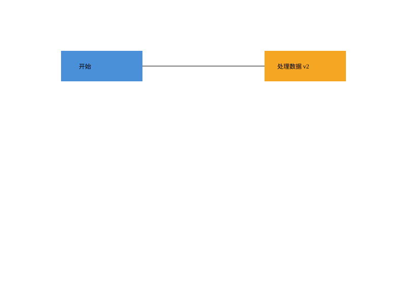

# SVG 编辑器 · Phase 1

用 TypeScript 编写的命令行 SVG 编辑器，支持六种图形、嵌套分组、撤销重做和 SVG 文件读写。

## 运行

需要 Node.js 22 或更新版本与 npm。在项目根目录执行：

```sh
npm ci
npm run cli
```

交互输入示例：

```text
init 400 200
create g flow
create rect start 30 70 120 60 #4a90d9 in flow
create text label 55 105 "开始" in flow
tree
move flow 20 0
undo
redo
save demo.svg
```

把生成的 SVG 文件拖入浏览器查看。输入 `help` 查看全部命令，`Ctrl+C` 或输入流 EOF 退出。

## 示例与检查

```sh
npm run example
npm run check
```

`example` 回放 [流程图脚本](examples/flowchart.commands)，生成 [flowchart.svg](examples/flowchart.svg)。
`check` 依次执行源码与测试类型检查、测试、构建。构建后可用 `node dist/main.js` 启动。



也可以通过标准输入执行命令脚本。脚本执行出错时，错误写入 stderr，后续命令继续执行，最终退出码为 1；全部成功时为 0。交互模式下显示 `svg>` 提示符。

## 命令

| 类别 | 命令 |
|---|---|
| 文档 | `init [w] [h]`、`read <file.svg>`、`save [file.svg]`、`canvas [w h]` |
| 编辑 | `create`、`delete`、`move`、`scale`、`set`、`group`、`ungroup`、`addto`、`front`、`back` |
| 显示 | `tree [id]`、`show <id>`、`help` |
| 历史 | `undo`、`redo` |

内置类型：`rect`、`circle`、`ellipse`、`line`、`text`、`g`。所有 `create` 命令都支持末尾的 `in <containerId>`。

带空格的内容或路径用双引号包裹，支持 `\"` 和 `\\` 转义。`#` 开头的整行是注释；参数中的 `#4a90d9` 是正常颜色。ID 必须非空、无空白、全局唯一且区分大小写。

每条编辑命令可以整体撤销，撤销后执行新编辑会清空 redo。`init/read/save` 和修改尺寸的 `canvas` 成功后清空旧历史，暂时禁止撤销；下一次编辑成功后恢复。失败的命令不改变文档、当前路径或历史。查询尺寸以及 `tree/show/help` 不影响历史。

## SVG 支持范围

读写上述六种元素的嵌套树、几何数值、fill/stroke/stroke-width，保留支持的文字和外观属性、data/aria 元数据及根 viewBox。读入缺失 ID 的元素时自动分配 ID 并警告。可通过 `read examples/other.svg` 检查作业中的外部导入用例。

目前不支持 `path/use/defs`、`transform`、CSS `style`、`tspan`、DTD、外部样式表和带 `px/%` 等单位的几何数值。导入时遇到这些内容会报错，原文档保留。`box` 留到后续阶段实现，本阶段按未知类型处理。

架构方案、开发记录和测试说明见 [doc/README.md](doc/README.md)。
