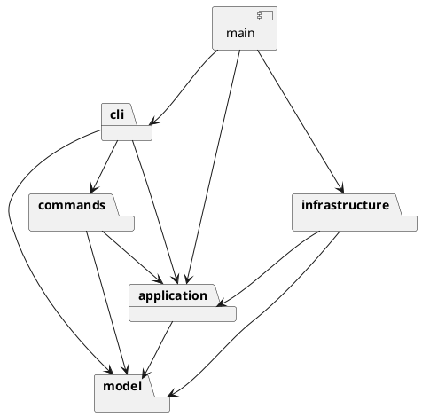

# SVG 编辑器 Phase 1：架构与开发记录

## 架构方案

### 模块划分

| 目录 | 职责 | 主要对象 |
|---|---|---|
| `src/model` | 封装几何、样式、图形树、ID 约束和结构变更 | Shape、六种具体图形、SvgDocument、ShapeFactory |
| `src/application` | 管理当前文档与文件路径，定义 IO 边界 | Editor、FileStore、DocumentCodec |
| `src/commands` | 执行用例，事务恢复与撤销重做 | Command、EditCommand、各具体 Command、CommandHistory |
| `src/cli` | 分词、命令注册、错误格式化与交互协调 | Tokenizer、CommandRegistry、CommandProcessor |
| `src/infrastructure` | 文件系统、XML 解析与 SVG 输出 | NodeFileStore、SvgCodec、XmlWriter |
| `src/main.ts` | 组装依赖、连接标准输入输出 | readline 启动入口 |
| `tests` | 模型、命令、SVG、真实进程与架构验收 | TestSession、TestFileStore 与测试用例 |
| `examples` | 可回放的流程图脚本、生成 SVG、外部导入样例 | flowchart.commands、flowchart.svg、other.svg |

所有类独立成文件，文件名与类名一致。Shape 的字段私有，通过行为方法操作；各叶子定义移动、克隆与摘要的多态行为，Group 持有并操作子对象。

组件图的源文件为 [architecture.puml](architecture.puml)：

### 设计模式及落地

**Command（必选）**：每个命令一个具体类。CommandProcessor 通过统一 execute 接口调用命令；编辑命令继承 EditCommand，成功后记录到 CommandHistory。显示命令不入栈，文档命令成功后建立历史屏障。

**Composite**：Shape 定义共同操作，叶子实现自身几何行为，Group 对子对象递归调用相同方法。命令调用 move/scale/set 时不按图形类型分支。组的样式写在 `<g>` 上，遵循 SVG 继承规则，子节点自己的显式样式仍有效，不强制覆盖每个后代。

**Memento**：编辑命令持有操作前后的文档深拷贝。撤销恢复前态，重做恢复后态，避免通过反向浮点运算或重放输入累计误差。复杂分组操作也能恢复父子关系和顺序。失败时恢复前态，不修改历史。clone 通过多态保留具体类型，不暴露可变内部字段。

**Factory 与依赖注入**：图形类型名只在 ShapeFactory 的定义表中映射到类；创建和 SVG 导入共用该表。命令名只在 CommandRegistry 中映射到实现。Editor 依赖 FileStore 和 DocumentCodec 接口，由入口注入具体对象。

按作业要求，**CommandRegistry 与 ShapeFactory 是两个待重构的名字分发点**：本阶段内置注册表，后续可提取注册接口让插件安装命令和图形定义。当前不实现动态插件加载，未注册的 box 按要求报错。

### 依赖方向规则

| 模块 | 允许依赖 | 理由 |
|---|---|---|
| model | model | 几何和树操作独立于交互、文件及 XML 库 |
| application | application、model | 协调文档生命周期，声明抽象 IO 接口 |
| commands | commands、application、model | 调用应用与模型行为，不接触实际文件系统 |
| cli | cli、commands、application、model | 解析输入并组装命令工厂，不直接读写 SVG 文件 |
| infrastructure | infrastructure、application、model | 实现上层接口，依赖模型读取和写入文档 |
| main | 全部模块 | 仅作为依赖组装入口 |

MarkupWriter 是 model 自己声明的序列化端口，模型不导入基础设施或 XML 类型。SvgCodec 使用真实 XML 解析器，不以正则解析 SVG 树；正则仅做词法、数值和支持范围校验。

### 变化点假设

1. **新增图形类型**：增加 Shape 子类及 ShapeDefinition 注册，复用命令与历史。暂不承诺新增复杂复合图形时内核零修改；那是后续插件阶段的目标。
2. **新增交互入口**：命令和 Editor 不依赖 readline；以后可由 GUI 或 agent 调用。当前反馈是字符串数组，多语言或结构化事件需求出现后再提取消息对象。
3. **替换存储或格式**：分别实现 FileStore 或 DocumentCodec；测试使用内存文件存储验证接口可替换。
4. **大型文档与长历史**：当前每次编辑保存前后完整文档，每条历史的时间与内存成本约 O(N)。针对本实验优先确保正确性，未做历史压缩；大型场景应改为局部 memento 或增量命令。
5. **扩大 SVG 范围**：保留 codec 边界。当前拒绝 transform/CSS/path 等特性；以后需要先制定坐标变换和样式级联规则，再增加支持。

## 行为决策与支持边界

- init 默认 800×600，只给宽度时高度仍为 600；canvas 修改尺寸要求宽高成对给出。画布尺寸为正，几何尺寸/半径和 stroke-width 非负，坐标可负，所有数值必须有限。
- group 至少选择一个图形，按原文档前序遍历顺序收编。新组放到所选图形的最近公共祖先内，位于第一个被选分支原来的位置。跨父容器时其余空容器保留。不允许重复选择，也不允许同时选择祖先与后代。
- ungroup 只允许非根级普通 g，子节点在原位置按顺序提升。addto 放到目标容器末尾，拒绝移动到自身或后代。
- SVG 后绘制的兄弟位于视觉前方，因此 front 放到兄弟列表末尾，back 放到开头。
- scale 同乘全部几何数值，包括位置。文本缩放 x/y，不缩放字体；stroke-width 属样式，不在几何缩放范围内。容器递归作用于后代。
- 文档操作成功后清空旧历史并禁止 undo/redo，下一条成功编辑建立新历史。失败操作不产生屏障。仅查询的 canvas 不产生屏障。help 在未初始化时也可用。
- save file.svg 成功后记住路径，后续 save 复用；init 清空路径。read 使用临时文档完全解析、验证后才替换当前文档。save 先写同目录临时文件，再重命名，失败时清理临时文件并保留应用状态。
- read 先预扫描所有显式 ID，再自动补 ID，避免与较晚出现的节点冲突；根 svg 的显式 ID 也占用 ID 空间。
- 支持六种元素；保留常见文字、透明度、描边外观及 data/aria 元数据。根 viewBox 可保留，修改画布尺寸会重设为 0 0 w h。没有尺寸时优先使用 viewBox 尺寸，否则使用默认画布尺寸。
- 未支持的元素、属性、CSS style、transform、tspan、DTD、外部样式表、带单位几何数值会报错，不会部分导入。普通 g 的 data-kind="box" 保留为元数据，仍按普通组操作。
- 文本 XML 转义覆盖 &、尖括号、引号和控制空白。换行/回车/制表符用数值实体保存，避免 XML 缩进改变文本内容。
- 错误输出单行 error:。批处理在错误后继续读取，退出码为 1。提示符仅在交互终端显示，整行 # 注释可回放。

## 过程记录

以下记录来自本次实际实现，不补造开发前不存在的历史。

1. **需求与架构**：初始目录只有 phase_cli_1.md。先识别 TypeScript/OOP、Command、Composite、两处分发、文档和 Git 约束；用户确认规划后开始实施。
2. **模型先行**：实现六种具体图形、统一抽象、树结构与 ID 校验，用模型测试验证分组、顺序、递归缩放和循环拒绝，然后单独提交。
3. **撤销方案修订**：原计划逐命令保存局部旧值；实现时统一为完整文档 memento。分组、删除、跨容器移动的恢复涉及多处顺序，完整快照更容易验证原子性。接受 O(N) 成本，大型文档前需要重构。
4. **读取边界**：背景示例展示 transform，但编辑规则定义的是直接几何操作。为避免保留的 transform 与后续几何编辑混用造成坐标歧义，当前选择明确拒绝，而非静默移除。限制写入使用说明。
5. **发现并修正 XML 缩进问题**：审查序列化时发现父节点的逐行缩进可能给文本换行插入空格。改为将控制空白编码为数值实体，并加入中文、emoji、CDATA、多行文本和属性往返测试。
6. **发现并修正 ID 冲突遗漏**：元素 ID 预扫描已避免自动 ID 与显式 ID 冲突，进一步补上根 svg 的 ID 预留及后续 create 冲突检查。
7. **测试自身修正**：逐命令撤销验收中，删除 a 后仍执行 show a，因节点缺失而失败。将观察目标换成保留的 scene，再验证显示操作不影响历史，没有因此放宽产品行为。
8. **真实 IO 与进程验收**：除内存测试，还启动实际 CLI 子进程，验证 EOF、stderr、退出码、UTF-8 文件路径和原子写入清理。

## 一致性自查

### 模块划分

实际目录与方案一致。细化增加 ShapeDefinition、Validation、MarkupWriter，分别承担图形参数、校验与输出端口职责，仍位于原定 model 模块；没有新增跨层业务目录。显示命令生成字符串，实际终端输出在 main 完成。

撤销从局部恢复数据改为整文档 memento，已记录于过程记录和变化点假设。

### 依赖方向

自动化架构检查扫描全部源码的静态相对 import，验证模块白名单；同时检查单文件最多一个导出类，且类名匹配文件名。

抽样：

- Rect/Group/SvgDocument 只依赖 model 内部类型，没有 fs、readline 或 XML 库。
- MoveCommand 调用 Editor.document 和 Shape.move，不导入具体叶子类。
- Editor 通过 FileStore/DocumentCodec 接口访问 IO，不导入 NodeFileStore/SvgCodec。
- SvgCodec 实现 DocumentCodec，使用 ShapeFactory 创建模型，未另建按标签名分派的 switch。
- main 负责创建真实 IO 与处理标准输入输出。

未发现违反依赖规则的 import。架构检查不声称能证明全部语义正确，行为测试负责覆盖实际用例。

## 质量保证手段

npm run check 执行源码与测试的严格类型检查、25 项测试及构建，全部通过。测试中的参数化循环覆盖多个命令与失败场景，不以单个测试数量代替命令覆盖。

| 验证内容 | 证据 |
|---|---|
| 六种图形、多态克隆、样式和嵌套树 | model.test.ts |
| 全部十种编辑命令的单步 undo/redo | commands.test.ts 参数化验收 |
| 删除子树、归属和顺序恢复 | 模型与命令往返快照比较 |
| 错误后文档/历史不变 | 重复 ID、缺失节点、循环、无效参数、越界数值等失败序列 |
| 文档屏障与 redo 清空 | init/read/save/canvas 修改，以及撤销后新编辑 |
| 读写失败保留文档和当前路径 | 模拟写入失败、缺失文件和损坏 XML |
| SVG 往返与自动补 ID | svg.test.ts、作业中的 other.svg 七元素用例 |
| 中文与 XML 文本 | 中文/emoji/引号/实体/CDATA/空文本/多行文本往返 |
| 真实 CLI 与文件系统 | acceptance.test.ts 子进程、原子文件替换与失败清理 |
| 架构一致性 | architecture.test.ts 扫描全部源码 |

npm run example 可回放作业中的流程图用例，生成浏览器可打开的 examples/flowchart.svg。另对构建后的 dist/main.js 执行冒烟检查。

已知限制：受限 SVG 导入范围、完整快照的内存成本、不含后续阶段的 box/插件；当前不实现 GUI。

## Git 与提交说明

本地提交依次包含工程与架构、图形模型、命令与历史、SVG/CLI 与验收，最后补全说明和示例。最终验收后在本地最终提交创建 final 标签。

初始目录未配置远程仓库。用户提供远程地址后才能推送提交和标签；没有声称已完成远程提交。作业截止时间未提供，本地标签不能证明已满足截止时间要求。

XML 解析依赖 @xmldom/xmldom，API 参考其[官方仓库文档](https://github.com/xmldom/xmldom)及已安装版本的类型声明。package-lock.json 固定实际安装依赖。
