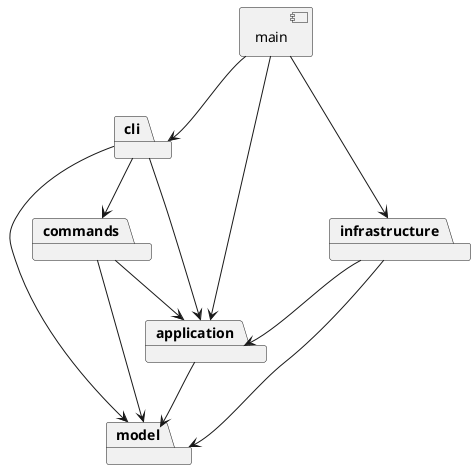

# SVG 编辑器 Phase 1：架构与开发记录

## 架构方案

### 模块划分

| 目录 | 职责 | 主要对象 |
|---|---|---|
| `src/model` | 管理图形的几何、样式、层级和 ID | Shape、六种具体图形、SvgDocument、ShapeFactory |
| `src/application` | 管理当前文档与文件路径，定义读写接口 | Editor、FileStore、DocumentCodec |
| `src/commands` | 执行命令，处理失败恢复与撤销重做 | Command、EditCommand、各具体 Command、CommandHistory |
| `src/cli` | 解析输入、分发命令、整理输出 | Tokenizer、CommandRegistry、CommandProcessor |
| `src/infrastructure` | 文件系统、XML 解析与 SVG 输出 | NodeFileStore、SvgCodec、XmlWriter |
| `src/main.ts` | 组装依赖、连接标准输入输出 | readline 启动入口 |
| `tests` | 模型、命令、SVG、真实进程与架构验收 | TestSession、TestFileStore 与测试用例 |
| `examples` | 可回放的流程图脚本、生成 SVG、外部导入样例 | flowchart.commands、flowchart.svg、other.svg |

每个类单独放在同名文件中。Shape 的字段设为私有，由方法修改；各图形分别实现移动、克隆和属性摘要，Group 则负责对子图形进行操作。

组件图的源文件为 [architecture.puml](architecture.puml)：

### 设计模式的选择

**Command**：每个命令对应一个类，由 CommandProcessor 调用 execute。编辑命令继承 EditCommand，成功后存入 CommandHistory；显示命令不入栈。文档命令执行成功后清空旧历史，并暂时禁止撤销。

**Composite**：Shape 定义图形共有的操作，具体图形修改自身几何数据，Group 递归调用子图形的方法。这样 move/scale/set 等命令可以统一处理图形和组。组的样式写在 `<g>` 上，按 SVG 规则继承，子节点自己设置的样式仍然有效。

**Memento**：编辑命令保存操作前后的文档副本，撤销和重做时直接恢复。这比反向计算坐标更容易处理浮点误差，也能还原分组后的父子关系和顺序。执行失败时恢复原文档，历史保持不变。副本通过各图形的 clone 方法生成。

**Factory 与依赖注入**：ShapeFactory 负责按类型创建图形，CLI 创建和 SVG 导入共用这套定义。CommandRegistry 负责按命令名选择实现。Editor 通过 FileStore 和 DocumentCodec 接口读写文件，具体对象在 main 中创建并传入。

CommandRegistry 和 ShapeFactory 是目前两处按名字分发的位置，也列为后续重构项。下一阶段可以开放注册接口，让插件添加命令和图形类型。当前尚未实现插件加载，create box 会报未知类型。

### 依赖方向规则

| 模块 | 允许依赖 | 理由 |
|---|---|---|
| model | model | 几何和树操作独立于交互、文件及 XML 库 |
| application | application、model | 协调文档生命周期，声明抽象 IO 接口 |
| commands | commands、application、model | 调用应用与模型行为，不接触实际文件系统 |
| cli | cli、commands、application、model | 解析输入并组装命令工厂，不直接读写 SVG 文件 |
| infrastructure | infrastructure、application、model | 实现上层接口，依赖模型读取和写入文档 |
| main | 全部模块 | 仅作为依赖组装入口 |

model 中的 MarkupWriter 接口用于输出图形，具体 XML 格式由 XmlWriter 处理。SvgCodec 使用 XML 解析库读取节点；正则只用于分词、数值格式和部分输入检查。

### 变化点假设

1. **增加图形类型**：添加 Shape 子类，在 ShapeFactory 中补充对应的 ShapeDefinition，已有命令和历史可以复用。复杂复合图形的扩展放到插件阶段处理。
2. **增加交互方式**：命令和 Editor 不依赖 readline，以后可以接入 GUI 或 agent。当前输出用字符串数组表示，暂未设计多语言或事件系统。
3. **更换存储或格式**：实现 FileStore 或 DocumentCodec 即可。测试中使用了内存文件存储。
4. **文档和历史变大**：每次编辑都保存完整文档，每条历史约占 O(N) 空间，N 为图形数。目前实验规模较小，先采用这种容易检查的方案；数据量增大后再改为局部快照或增量记录。
5. **支持更多 SVG 特性**：相关修改集中在 codec 中。transform、CSS 和 path 需要额外处理坐标变换及样式规则，本阶段暂未加入。

## 部分实现约定

- init 默认 800×600，只给宽度时高度仍为 600；canvas 修改尺寸要求宽高成对给出。画布尺寸为正，几何尺寸/半径和 stroke-width 非负，坐标可负，所有数值必须有限。
- group 至少选择一个图形，按原文档前序遍历顺序收编。新组放到所选图形的最近公共祖先内，位于第一个被选分支原来的位置。跨父容器时其余空容器保留。不允许重复选择，也不允许同时选择祖先与后代。
- ungroup 只允许非根级普通 g，子节点在原位置按顺序提升。addto 放到目标容器末尾，拒绝移动到自身或后代。
- SVG 后绘制的兄弟位于视觉前方，因此 front 放到兄弟列表末尾，back 放到开头。
- scale 同乘全部几何数值，包括位置。文本缩放 x/y，不缩放字体；stroke-width 属样式，不在几何缩放范围内。容器递归作用于后代。
- 文档操作成功后清空旧历史并禁止 undo/redo，下一条成功编辑建立新历史。失败操作不产生屏障。仅查询的 canvas 不产生屏障。help 在未初始化时也可用。
- save file.svg 成功后记住路径，后续 save 复用；init 清空路径。read 使用临时文档完全解析、验证后才替换当前文档。save 先写同目录临时文件，再重命名，失败时清理临时文件并保留应用状态。
- read 先预扫描所有显式 ID，再自动补 ID，避免与较晚出现的节点冲突；根 svg 的显式 ID 也占用 ID 空间。
- 支持六种元素；保留常见文字、透明度、描边外观及 data/aria 元数据。根 viewBox 可保留，修改画布尺寸会重设为 0 0 w h。没有尺寸时优先使用 viewBox 尺寸，否则使用默认画布尺寸。
- 未支持的元素、属性、CSS style、transform、tspan、DTD、外部样式表、带单位几何数值会报错，不会部分导入。普通 g 的 data-kind="box" 保留为元数据，仍按普通组操作。
- 文本 XML 转义覆盖 &、尖括号、引号和控制空白。换行/回车/制表符用数值实体保存，避免 XML 缩进改变文本内容。
- 错误输出单行 error:。批处理在错误后继续读取，退出码为 1。提示符仅在交互终端显示，整行 # 注释可回放。

## 过程记录

开发中使用 Codex 辅助规划、编写代码和测试。几处主要调整如下：

1. **先做模型**：根据 phase_cli_1.md 确定模块划分，先实现六种图形和树操作，测试分组顺序、递归缩放和循环检查，再接入命令。
2. **调整撤销方案**：最初准备让每条命令保存局部旧值。实现分组、删除和跨容器移动时，发现需要分别记录多个父节点和位置，改用完整文档快照，代价是更高的内存占用。
3. **确定导入范围**：背景示例中有 transform，但当前模型直接修改几何坐标。暂时拒绝导入 transform，避免编辑后的坐标含义不清，限制已写入使用说明。
4. **修正文本缩进**：检查序列化代码时发现，给子节点逐行缩进会改变多行文本。改为把换行、回车和制表符写成数值实体，并补充往返测试。
5. **补上根节点 ID 检查**：自动分配 ID 时已预留所有图形 ID，后来又补上根 svg 的 ID，防止新建图形与根节点重名。
6. **修正测试用例**：撤销测试删除 a 后还调用 show a，导致测试失败。把查询对象换成保留的 scene，继续检查显示命令是否影响历史。
7. **检查实际运行**：通过 CLI 子进程和终端操作检查 EOF、错误输出、退出码、中文路径及文件写入失败后的清理。

## 一致性自查

### 模块划分

实际目录与方案一致。实现中增加了 ShapeDefinition、Validation、MarkupWriter，分别处理图形参数、校验和输出接口，均放在 model 中。显示命令生成字符串，由 main 输出到终端。

撤销从局部恢复数据改为整文档 memento，已记录于过程记录和变化点假设。

### 依赖方向

自动化架构检查扫描全部源码的静态相对 import，验证模块白名单；同时检查单文件最多一个导出类，且类名匹配文件名。

抽样：

- Rect/Group/SvgDocument 只依赖 model 内部类型，没有 fs、readline 或 XML 库。
- MoveCommand 调用 Editor.document 和 Shape.move，不导入具体叶子类。
- Editor 通过 FileStore/DocumentCodec 接口访问 IO，不导入 NodeFileStore/SvgCodec。
- SvgCodec 实现 DocumentCodec，使用 ShapeFactory 创建模型，未另建按标签名分派的 switch。
- main 负责创建真实 IO 与处理标准输入输出。

检查结果符合上述依赖规则。命令行为另外通过测试验证。

## 质量保证手段

`npm run check` 包括类型检查、25 项测试和构建，均已通过。其中部分测试循环检查多条命令或多种错误输入。

| 验证内容 | 证据 |
|---|---|
| 六种图形、多态克隆、样式和嵌套树 | model.test.ts |
| 全部十种编辑命令的单步 undo/redo | commands.test.ts 参数化验收 |
| 删除子树、归属和顺序恢复 | 模型与命令往返快照比较 |
| 错误后文档/历史不变 | 重复 ID、缺失节点、循环、无效参数、越界数值等失败序列 |
| 文档屏障与 redo 清空 | init/read/save/canvas 修改，以及撤销后新编辑 |
| 读写失败保留文档和当前路径 | 模拟写入失败、缺失文件和损坏 XML |
| SVG 往返与自动补 ID | svg.test.ts、作业中的 other.svg 七元素用例 |
| 中文与 XML 文本 | 中文/emoji/引号/实体/CDATA/空文本/多行文本往返 |
| 真实 CLI 与文件系统 | acceptance.test.ts 子进程、原子文件替换与失败清理 |
| 架构一致性 | architecture.test.ts 扫描全部源码 |

`npm run example` 执行作业中的流程图用例，生成 examples/flowchart.svg，可直接用浏览器打开。构建后的 dist/main.js 也进行了终端运行检查。

目前的主要限制是 SVG 导入范围较小、完整快照占用较多内存。box 和插件留到后续阶段，暂未实现 GUI。

## Git 与提交说明

代码按工程搭建、图形模型、命令与历史、SVG 读写及测试、文档和示例分步提交。本次另作一次 README 文字修订。

远程仓库：[Logosis/svg-editor](https://github.com/Logosis/svg-editor)。提交分支为 main，作业版本使用 final 标签。

XML 解析依赖 @xmldom/xmldom，API 参考其[官方仓库文档](https://github.com/xmldom/xmldom)及已安装版本的类型声明。package-lock.json 固定实际安装依赖。
